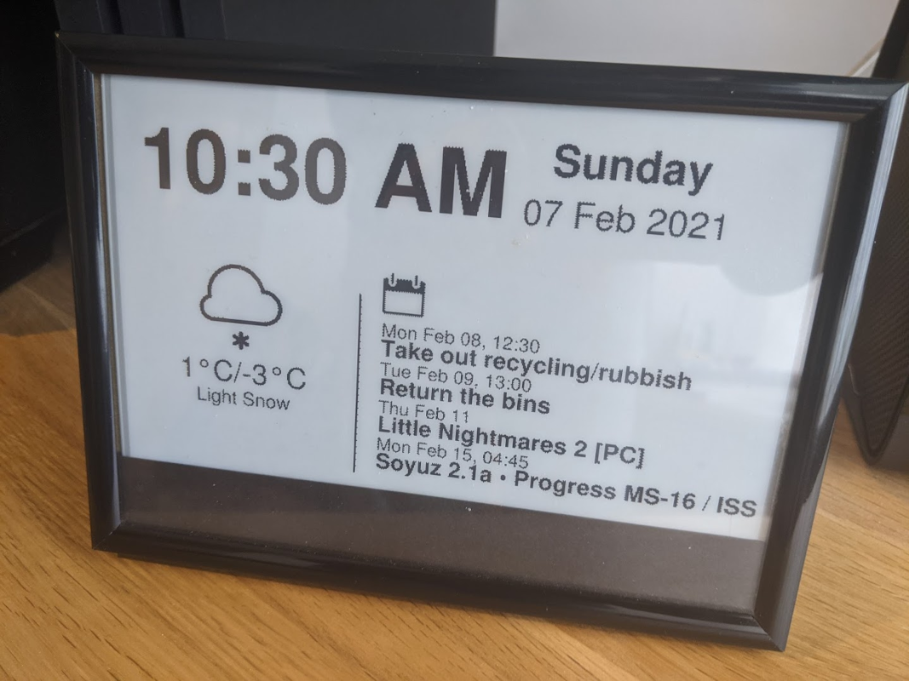

# Waveshare E-Paper Display

This project sets up a dashboard for a **Raspberry Pi** paired with a **Waveshare 7.5" e-Paper HAT**.   
It shows the date, time, weather, and calendar entries, from a variety of providers.  
There is also an optional privacy mode, and other customizable appearance options.  

## Instructions

All setup and configuration instructions live on the **docs site** 👉 https://code.mendhak.com/waveshare-epaper-display/

### Overview

To get your dashboard running, you will need to go through:

1. **[Shopping list](https://code.mendhak.com/waveshare-epaper-display/getting-started/shopping-list/)** to get the hardware you need (Pi, HAT, display, SD card, frame).
2. **[Hardware setup](https://code.mendhak.com/waveshare-epaper-display/getting-started/hardware-setup/)** to flash the Pi, mount the HAT, and connect the display.
3. **[Application setup](https://code.mendhak.com/waveshare-epaper-display/getting-started/application-setup/)** to clone the repo, install dependencies, and create your `config.toml`.
4. **[Configuration](https://code.mendhak.com/waveshare-epaper-display/configuration/)** to set your location, version, and desired layout. 
5. **[Weather](https://code.mendhak.com/waveshare-epaper-display/weather/)** to pick a weather provider (OpenWeatherMap, Met Office, AccuWeather, Met.no, Weather.gov, VisualCrossing, SMHI, Met Éireann, Climacell).
6. **[Alerts](https://code.mendhak.com/waveshare-epaper-display/alerts/)** to optionally add severe weather warnings.
7. **[Calendar](https://code.mendhak.com/waveshare-epaper-display/calendar/)** to add a calendar provider (Google, Outlook, ICS, or CalDAV). 
8. **[Running it](https://code.mendhak.com/waveshare-epaper-display/running/)** to run `./run.sh` manually, or automate it with cron or a systemd timer.

Once it's running you can tweak the [appearance](https://code.mendhak.com/waveshare-epaper-display/appearance/) (custom data, language, font) and toggle [privacy mode](https://code.mendhak.com/waveshare-epaper-display/privacy/).

## Photos

  

## License

See [LICENSE](LICENSE).
